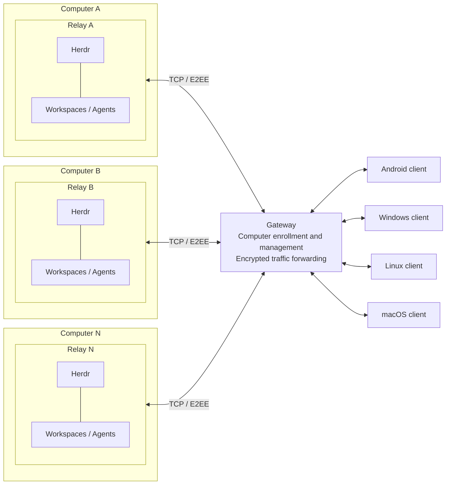

# Herdr Link

[简体中文](README.md) · **English**

A self-hosted system for connecting **multiple computers running Herdr to multiple clients**. A Relay connects to Herdr on each computer, a Gateway manages computer enrollment and forwards encrypted traffic, and Android and desktop clients provide conversations, terminals, approvals, and file access.

[Architecture](#architecture) · [Gateway](#gateway) · [Relay](#relay) · [Clients](#clients) · [Quick start](#quick-start) · [Security and operations](#security-and-operations)

## Architecture



- **One Relay per computer.** Run it as the same user as Herdr and your agents. It provides session, terminal, file, and device-authorization APIs. The nested boxes show the access boundary; Relay, Herdr, and agents are separate processes.
- **Many Relays, one Gateway.** Computers connect outbound to the Gateway; they do not need public inbound ports. The Gateway forwards encrypted application data without reading or storing conversation text.
- **Many clients, independent permissions.** A client can pair with multiple computers, and each computer can authorize multiple clients. Every client gets its own pairing credentials and role.
- **Direct local connections.** Windows and Linux clients can connect to a same-user local Relay without a Gateway. Windows can also connect to a Relay in a running WSL distribution. Device authentication and end-to-end encryption still apply.

| Component | Runs on | Source |
| --- | --- | --- |
| Gateway | A publicly reachable server | `cmd/herdr-gateway` |
| Relay | Each computer running Herdr | `cmd/herdr-mobile-relay` |
| Herdr Pocket | Android phones and tablets | `herdr-android/` |
| Herdr Desktop | Windows, Linux, and macOS | `desktop/` |

Installing a desktop **client** does not automatically share that computer's agents. To make a computer remotely accessible, run Herdr and a Relay on it too.

## Quick start

1. **Install the Gateway** on a server and expose TCP **8377**. Keep its management interface private; access it through an SSH tunnel.
2. **Create a computer enrollment code** in the Gateway management page. It starts with `herdr-gateway://`.
3. **Install a Relay** on each Herdr computer, run `gateway-join`, paste its enrollment code, and start the Relay.
4. **Pair a client** using a new `herdr-tcp://` invitation from that computer's running Relay. Choose a name for the computer in the client.

These credentials serve different purposes:

| Credential | Purpose |
| --- | --- |
| Gateway administrator key or password | Sign in to the Gateway management page |
| `herdr-gateway://` enrollment code | Register a computer's Relay with the Gateway |
| `herdr-tcp://` pairing invitation | Authorize one Android or desktop client on that computer |

Do not paste a Gateway enrollment code into the client. Create a separate client invitation for each device. **Reader** permits viewing; **Controller** permits terminal input, prompts, and management actions subject to the Relay's target checks. Invitations created in the client default to Reader, so select Controller if the new device needs to operate agents.

**Already have a running Linux Relay?** Generate an invitation as its user:

```sh
~/.local/share/herdr-pocket-relay/current/run.sh tcp-pair 'My phone'
```

Use the actual installation path and configuration if yours differs. Do not initialize a second Relay or replace its device database just to add a client.

## Get the source

Skip compilation if you use the prebuilt [server packages](#server-packages) or [client downloads](#clients).

```sh
git clone https://github.com/cxnaive/herdr_link.git
cd herdr_link
```

Run Gateway and Relay build commands from the repository root. Client commands use their respective subdirectories. Toolchain versions are pinned in `go.mod`, the Gradle Wrapper, and the CI workflows.

## Gateway

The Gateway manages which computers can connect and routes clients to their Relays. Its private web console supports computer names, online status, client counts, monthly forwarded traffic, expiring enrollment codes, disabling and restoring access, credential revocation, and capacity limits.

### Build the Gateway

Use **Go 1.27.3**, as specified in `go.mod`:

```sh
mkdir -p bin
CGO_ENABLED=0 go build -trimpath -o bin/herdr-gateway ./cmd/herdr-gateway
# For Linux ARM64, also set GOOS=linux GOARCH=arm64 before go build.
```

### Deploy the Gateway

The following is a **first-time, foreground setup**. Replace `PUBLIC_HOST` with your server's public IP address or hostname. For a dedicated service user, fixed installation paths, and systemd configuration, see [Gateway management](docs/gateway-management.md).

```sh
# Initialize once and securely save the administrator key printed by this command.
./bin/herdr-gateway admin-init --state-dir "$HOME/.local/share/herdr-gateway/management"

HERDR_GATEWAY_TCP_ADDR=0.0.0.0:8377 \
HERDR_GATEWAY_ADDR=127.0.0.1:18377 \
HERDR_GATEWAY_STUN_ADDR= \
HERDR_GATEWAY_ADMIN_STATE="$HOME/.local/share/herdr-gateway/management" \
HERDR_GATEWAY_ADMIN_ADDR=127.0.0.1:18378 \
HERDR_GATEWAY_ADMIN_ORIGIN=http://127.0.0.1:18378 \
HERDR_GATEWAY_PUBLIC_ENDPOINT=tcp://PUBLIC_HOST:8377 \
./bin/herdr-gateway
```

Expose only **TCP 8377** for the Gateway's application traffic. Keep health port `18377` and management port `18378` on loopback. Open the management page through SSH forwarding:

```sh
ssh -N -L 18378:127.0.0.1:18378 user@PUBLIC_HOST
# Open http://127.0.0.1:18378 in your browser.
```

Sign in and generate a `herdr-gateway://` code for each computer. The Gateway is **not limited to two computers**; adjust its capacity in the management page. Management-based enrollment requires Herdr Link 0.3.0 or newer. Existing static allow-list installations can migrate while preserving computer identities and client pairing; see the [migration guide](docs/gateway-management.md#迁移已有电脑).

## Relay

Run the Relay under the **same user as Herdr and the agents**. It accesses that user's Herdr endpoint, conversation files, and workspaces. The Gateway does not read these files on the Relay's behalf.

### Build the Relay

```sh
# Repository root, Go 1.27.3; Linux/macOS shell.
CGO_ENABLED=0 go build -trimpath -o bin/herdr-mobile-relay ./cmd/herdr-mobile-relay
# For Linux ARM64, also set GOOS=linux GOARCH=arm64 before go build.
```

For a native Windows build, use PowerShell:

```powershell
$env:CGO_ENABLED = '0'
go build -trimpath -o bin/herdr-mobile-relay.exe ./cmd/herdr-mobile-relay
```

Keep the `web/` bundle alongside the installation or set `HERDR_WEB_ROOT` explicitly. Building a binary is not the same as installing its configuration and service scripts.

### Deploy and enroll on Linux

Install and start Herdr first. The following is **first-time initialization only**; do not regenerate a working Relay's master key or delete its device database.

```sh
export HERDR_RELAY_ENV="$HOME/.config/herdr-mobile-relay/relay.env"
python3 deploy/native-relay/init-config.py --gateway tcp://PUBLIC_HOST:8377
set -a
. "$HERDR_RELAY_ENV"
set +a

# Paste the computer enrollment code from the Gateway management page.
./bin/herdr-mobile-relay gateway-join

# Keep this process running; open another terminal to pair clients.
HERDR_WEB_ROOT="$PWD/web" ./bin/herdr-mobile-relay serve
```

Production Linux installations use versioned directories, a `current` link, and a **systemd user service**. Follow the [Relay installation guide](docs/native-deployment.md#安装电脑-relay). Do not run the computer Relay as root or start two instances using the same device store.

### Deploy and enroll on Windows

Install native Herdr and **PowerShell 7**, then extract the complete Windows Relay ZIP. In that directory:

```powershell
./install.ps1
./run.ps1 gateway-join
# Paste the Gateway computer enrollment code when prompted.
./run.ps1 serve
```

Use the same ordinary Windows account for Herdr, the Relay, and agents. Configuration is stored under `%LOCALAPPDATA%\HerdrLink\relay`, protected by Windows ACLs. The current package runs in the foreground; it does not install a Windows Service or scheduled task.

Windows x64 Codex binding supports verified shared and embedded runtimes. Model/reasoning settings for `--no-daemon` or other embedded runtimes must be changed in the Codex terminal. Pi's Unix command bridge, direct PTY ioctl size leases, Unix signals, and plugin self-updates are not available on Windows. See [Windows Relay](docs/windows-relay.md) for requirements and validation limits.

### Pair clients

Generate each client's invitation through the **running Relay**, using the same configuration:

```sh
# Linux deployment package:
~/.local/share/herdr-pocket-relay/current/run.sh tcp-pair 'My desktop'

# Source-built Relay: load the same configuration in a second terminal.
export HERDR_RELAY_ENV="$HOME/.config/herdr-mobile-relay/relay.env"
set -a; . "$HERDR_RELAY_ENV"; set +a
./bin/herdr-mobile-relay tcp-pair 'My desktop'
```

```powershell
# Windows deployment package, in a second PowerShell window:
./run.ps1 tcp-pair 'My phone'
```

Give the resulting `herdr-tcp://` invitation to the client. This is different from the Gateway administrator password and the computer enrollment code.

<!-- native-downloads:start -->
### Server packages

**[Herdr Link v0.3.3](https://github.com/cxnaive/herdr_link/releases/tag/v0.3.3)** · Relay and Gateway share the project version

| Component | Linux x86_64 | Linux ARM64 |
| --- | --- | --- |
| Relay | [Deployment package](https://github.com/cxnaive/herdr_link/releases/download/v0.3.3/herdr-link-relay-0.3.3-linux-amd64.tar.gz) | [Deployment package](https://github.com/cxnaive/herdr_link/releases/download/v0.3.3/herdr-link-relay-0.3.3-linux-arm64.tar.gz) |
| Gateway | [Deployment package](https://github.com/cxnaive/herdr_link/releases/download/v0.3.3/herdr-link-gateway-0.3.3-linux-amd64.tar.gz) | [Deployment package](https://github.com/cxnaive/herdr_link/releases/download/v0.3.3/herdr-link-gateway-0.3.3-linux-arm64.tar.gz) |

[Checksums](https://github.com/cxnaive/herdr_link/releases/download/v0.3.3/SHA256SUMS.txt) · [Installation instructions](https://github.com/cxnaive/herdr_link/releases/download/v0.3.3/INSTALL.md) · [Deployment guide](docs/native-deployment.md)

Complete packages include the executable, configuration, and service templates. Choose amd64 (x86_64) or arm64 (aarch64) for your host. macOS server binaries are available only as standalone CI artifacts.

**Windows x86_64 Relay:** [Complete ZIP](https://github.com/cxnaive/herdr_link/releases/download/v0.3.3/herdr-link-relay-0.3.3-windows-amd64.zip) · [Installation instructions](https://github.com/cxnaive/herdr_link/releases/download/v0.3.3/INSTALL.md). Requires native Herdr and PowerShell 7, running as the same ordinary user.
<!-- native-downloads:end -->

## Clients

Clients organize remote work as **Computer → Workspace → Agent**, with collapsible groups and per-computer running/waiting counts. A computer name in a client is a local label: it does not change the Relay's identity or automatically update the Gateway's management label.

When an agent exits but its Herdr panel remains open, an updated Relay keeps that panel accessible as a terminal. Upgrade the Relay as well as the client when a feature requires both.

### Android · Herdr Pocket

A native Android client with paginated conversation history, collapsible tool calls, terminal input, file preview/upload/download, and optional background completion notifications.

<!-- pocket-preview:start -->
<table>
  <tr>
    <td align="center" valign="top" width="25%">
      <a href="images/pocket/agents.png"></a>
      <br /><sub>Computers and workspaces</sub>
    </td>
    <td align="center" valign="top" width="25%">
      <a href="images/pocket/conversation.png"></a>
      <br /><sub>Conversations and tool calls</sub>
    </td>
    <td align="center" valign="top" width="25%">
      <a href="images/pocket/terminal.png"></a>
      <br /><sub>Terminal and extra keys</sub>
    </td>
    <td align="center" valign="top" width="25%">
      <a href="images/pocket/workspace.png"></a>
      <br /><sub>Workspace files</sub>
    </td>
  </tr>
</table>

<sub>UI previews from 0.2.23, rendered with native controls and demo data. Click to enlarge. Screenshots show the Chinese interface.</sub>
<!-- pocket-preview:end -->

<!-- android-downloads:start -->
#### Download Android APKs

**[Herdr Link v0.3.3 · Android](https://github.com/cxnaive/herdr_link/releases/tag/v0.3.3)** · Android 9 or later

| Device | APK |
| --- | --- |
| Most phones and tablets | [arm64-v8a](https://github.com/cxnaive/herdr_link/releases/download/v0.3.3/herdr-link-android-0.3.3-arm64-v8a.apk) |
| 32-bit ARM | [armeabi-v7a](https://github.com/cxnaive/herdr_link/releases/download/v0.3.3/herdr-link-android-0.3.3-armeabi-v7a.apk) |
| x86_64 devices and emulators | [x86_64](https://github.com/cxnaive/herdr_link/releases/download/v0.3.3/herdr-link-android-0.3.3-x86_64.apk) |

Install over the existing app; **do not uninstall it first**. Published APKs retain the Pocket application ID and signing identity, preserving pairing and drafts. Locally signed APKs may not be installable over a published build. Debug APKs remain in CI, not in the formal release downloads.
<!-- android-downloads:end -->

#### Build and install Android

Requires **JDK 21, Android SDK 35, and Build Tools 35.0.0**. Use the included Gradle Wrapper:

```sh
cd herdr-android
export JAVA_HOME=/path/to/jdk-21
export ANDROID_HOME=/path/to/android-sdk
./gradlew --no-daemon testDebugUnitTest assembleDebug
adb install -r app/build/outputs/apk/debug/app-debug.apk
```

You can also copy the APK to the phone and install it there. A local build may use a different signing key from the published APK; **do not uninstall an existing app containing pairing data just to resolve a signature mismatch**. See the [Android guide](herdr-android/README.md).

<!-- desktop-downloads:start -->
### Desktop downloads

**[Herdr Link v0.3.3 · Desktop](https://github.com/cxnaive/herdr_link/releases/tag/v0.3.3)**

| Platform | Installation |
| --- | --- |
| Windows x86_64 | [Portable ZIP](https://github.com/cxnaive/herdr_link/releases/download/v0.3.3/herdr-link-desktop-0.3.3-windows-amd64.zip); extract and run `Herdr Desktop.exe` |
| Debian / Ubuntu x86_64 | [Debian package](https://github.com/cxnaive/herdr_link/releases/download/v0.3.3/herdr-link-desktop-0.3.3-linux-amd64.deb); install with `sudo apt install ./filename.deb` |
| Linux x86_64 user installation | [Archive](https://github.com/cxnaive/herdr_link/releases/download/v0.3.3/herdr-link-desktop-0.3.3-linux-amd64.tar.gz) + [Installer](https://github.com/cxnaive/herdr_link/releases/download/v0.3.3/herdr-link-desktop-0.3.3-linux-amd64-install.sh) |
| Debian / Ubuntu ARM64 | [Debian package](https://github.com/cxnaive/herdr_link/releases/download/v0.3.3/herdr-link-desktop-0.3.3-linux-arm64.deb); install with `sudo apt install ./filename.deb` |
| Linux ARM64 user installation | [Archive](https://github.com/cxnaive/herdr_link/releases/download/v0.3.3/herdr-link-desktop-0.3.3-linux-arm64.tar.gz) + [Installer](https://github.com/cxnaive/herdr_link/releases/download/v0.3.3/herdr-link-desktop-0.3.3-linux-arm64-install.sh) |
| macOS 12+ · Apple Silicon / Intel | [Universal DMG](https://github.com/cxnaive/herdr_link/releases/download/v0.3.3/herdr-link-desktop-0.3.3-macos-universal.dmg); drag the app into Applications |

Windows/Linux desktop apps are unsigned. The macOS preview is ad-hoc signed, without Developer ID signing or Apple notarization; first launch may require approval in System Settings. Linux requires GTK 3, WebKitGTK 4.1, libsecret, and an unlocked Secret Service keyring. Sharing a project version does not imply equal validation coverage on every platform.
<!-- desktop-downloads:end -->

### Windows · Herdr Desktop

Download the portable ZIP above, extract it, and run `Herdr Desktop.exe`. Keep `ghostty-vt.dll` in the same directory.

To build on Windows with **Go 1.27.3**:

```powershell
cd desktop
./scripts/build.ps1 -Platform windows/amd64
& './build/windows-amd64/Herdr Desktop.exe'
```

### Linux · Herdr Desktop

Uses the same application code as Windows. Requires a graphical desktop, **GTK 3, WebKitGTK 4.1, libsecret, and an unlocked Secret Service keyring**.

Choose amd64 for `uname -m` = `x86_64`, or arm64 for `aarch64`. Use the filenames matching your downloaded version and architecture:

```sh
# Debian / Ubuntu:
sudo apt install ./herdr-link-desktop-0.3.3-linux-amd64.deb

# Or install without root, with the script and archive in the same directory:
sh herdr-link-desktop-0.3.3-linux-amd64-install.sh herdr-link-desktop-0.3.3-linux-amd64.tar.gz
~/.local/bin/herdr-desktop
```

Build and package for the current machine's amd64/arm64 architecture:

```sh
cd desktop
./scripts/build-linux.sh
python3 scripts/package-linux.py
# Output: build/artifacts-linux-amd64/ or build/artifacts-linux-arm64/
```

Windows and Linux clients offer **Add computer → Find local Relay → Connect locally**. Windows can also discover Relays in already-running WSL distributions under their default Linux users; Python 3.9+ is required inside the distribution. Discovery does not start WSL or the Relay, read the master key, or import phone credentials. See [local connections](desktop/README.md#windows--linux-连接本机-relay).

### macOS · Herdr Desktop

The **Universal DMG** supports Apple Silicon and Intel, with a declared minimum of macOS 12. Drag the complete app into Applications.

The app is **ad-hoc signed, not Developer ID signed or Apple-notarized**. After verifying the source, you may need to use **System Settings → Privacy & Security → Open Anyway**. Do not disable system-wide security checks; organization-managed Macs may not allow an exception.

To build on macOS with Go 1.27.3:

```sh
cd desktop
./scripts/build-macos.sh
python3 scripts/package-macos.py
# Output: build/artifacts-macos-universal/
```

CI tests the same DMG on macOS 15 Apple Silicon and Intel runners. That does not establish full support for every older macOS version or interaction. This is a remote client; it does not imply support for Mac-local Relay discovery or Codex process binding. See the [macOS guide](desktop/README.md#macos).

### Appearance

Android, desktop, and Web clients offer five matching palettes: **Mint Dark, Midnight Blue, Graphite Purple, Cloud Blue, and Warm Paper**. The first three are dark; the last two are light.

- Android: **Devices → Theme colors**.
- Desktop: **Appearance → App theme** in the sidebar. Terminal colors are configured separately.
- Web: **Settings → Appearance → Theme**. The new palettes retain a dark terminal; the existing Latte light terminal remains available.

These names describe the controls; some client interfaces are currently in Chinese. Choices stay on the current client and do not change remote settings, reconnect sessions, or discard drafts and pending operations.

## Security and operations

- **Preserve identity during upgrades.** Keep the Relay key, configuration, and device database. Restart only the component you are upgrading, not Herdr or its agents. Merely installing a new client does not upgrade the remote Relay.
- **Keep file access scoped.** The default scope is the current agent workspace. A Controller must explicitly authorize a wider read-only scope.
- **Do not guess conversation identity.** When the Relay cannot verify the session, it reports the uncertainty rather than opening another conversation. Provider-specific history support and running-state evidence have different limits; see [conversation support](docs/conversation-activity.md) and [session binding](docs/primary-session-binding.md).
- **Protect credentials.** Application data is end-to-end encrypted, but network addresses, routing IDs, traffic sizes, and timing remain visible. Never publish keys, complete invitations, or runtime configuration.
- **Account for notification limits.** Android completion notifications depend on a persistent connection, not cloud push. Network loss, force-stop, and battery restrictions can delay or suppress them.

On Linux, check the running Relay with:

```sh
systemctl --user is-active herdr-mobile-relay.service
curl -fsS http://127.0.0.1:8375/healthz
```

Look for `readiness: "ready"` and `gateway.registered: true` when using a Gateway. Replace port `8375` if configured differently. If an agent is missing, check the Relay user and Herdr endpoint. If history is unavailable, check that provider's integration and binding diagnostics before changing pairing data.

### CI builds versus releases

Routine pushes run component-scoped checks and builds. Download unreleased builds from [Actions](https://github.com/cxnaive/herdr_link/actions) → a successful run → **Artifacts**. For Android upgrades, select **`android-apks-signed`**, not the unsigned/intermediate CI output. Check the commit and `BUILD-INFO.json`, since development builds may share a version number.

CI artifacts are temporary: Linux Relay/Gateway and Android artifacts currently remain for 1 day, Windows Relay and desktop artifacts for 7 days. Routine CI does **not** create a GitHub Release or deploy to your computers. Formal releases are explicitly built, verified, and published from CI. See [CI and release procedures](docs/native-ci.md).

## Documentation

Some detailed guides are currently in Chinese; the repository also contains English protocol and development documentation.

[Chinese quick start](QUICKSTART.md) · [Installation, upgrades, and troubleshooting](docs/native-deployment.md) · [Gateway management](docs/gateway-management.md) · [Windows Relay](docs/windows-relay.md) · [File permissions](docs/file-access.md) · [Building and testing](docs/building.md) · [CI and releases](docs/native-ci.md)

See [VERSION.json](VERSION.json) for component versions and release provenance, and [CHANGELOG.md](CHANGELOG.md) for changes. This is an extension of Herdr Relay, **not an official upstream release**. Published assets are built and released through CI. The project uses standard `vMAJOR.MINOR.PATCH` tags with one release containing the supported components.

See [LICENSE](LICENSE) for licensing and [Android third-party notices](herdr-android/THIRD_PARTY.md) for bundled dependencies.
