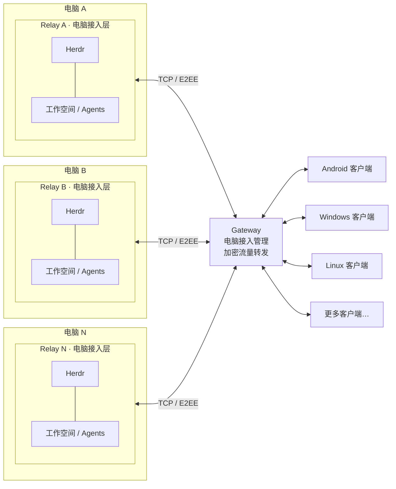

# Herdr Link

一套连接 **多台 Herdr 电脑与多个客户端**的自托管系统。Relay 负责接入电脑上的 Herdr，Gateway 负责电脑注册和加密流量转发，Android 与桌面客户端提供对话、终端、审批和文件操作界面。

[系统架构](#系统架构) · [Gateway](#gateway) · [Relay](#relay) · [Clients](#clients) · [快速开始](QUICKSTART.md) · [安装与升级](docs/native-deployment.md)

## 系统架构



- **每台电脑一个 Relay**：与 Herdr / Agent 使用同一用户，提供会话、终端、文件和设备鉴权接口。图中外框表示接入边界，Relay、Herdr 和 Agent 仍是独立进程。
- **多个 Relay 连接一个 Gateway**：电脑主动向 Gateway 建立出站连接，电脑本身无需开放公网端口。Gateway 只转发加密的应用数据，不保存或解析对话正文。
- **多个客户端连接 Gateway**：一个客户端可配对多台电脑，一台电脑也可授权多个客户端；每个客户端独立配对、独立授权。
- **本机连接例外**：Windows / Linux 客户端可直连当前用户的本机 Relay；Windows 也可连接已运行的 WSL 中的 Relay。不经过 Gateway，仍进行设备鉴权和端到端加密。

| 组件 | 部署位置 | 源码 |
| --- | --- | --- |
| Gateway | 公网服务器 | `cmd/herdr-gateway` |
| Relay | 每台运行 Herdr 的电脑 | `cmd/herdr-mobile-relay` |
| Herdr Pocket | Android 手机 / 平板 | `herdr-android/` |
| Herdr Desktop | Windows / Linux / macOS | `desktop/` |

## 获取源码

只使用预编译包可跳过编译，直接看[服务端安装包](#服务端安装包)或 [Clients](#clients)。源码构建先执行一次：

```sh
git clone https://github.com/cxnaive/herdr_link.git
cd herdr_link
```

下文 Gateway / Relay 命令在仓库根目录运行，客户端命令进入各自子目录。工具链固定版本见 `go.mod`、Gradle Wrapper 和 CI 配置。

## Gateway

Gateway 管理允许接入的电脑，将客户端连接路由到对应 Relay。管理页支持电脑命名、在线状态、客户端连接数、月度转发流量、限时接入码、禁用／恢复、撤销凭据和容量设置。

### 编译

在仓库根目录执行；Go 版本以 `go.mod` 为准，当前为 **1.27.3**：

```sh
mkdir -p bin
CGO_ENABLED=0 go build -trimpath -o bin/herdr-gateway ./cmd/herdr-gateway
# 交叉编译 Linux ARM64：在上行 go build 前加 GOOS=linux GOARCH=arm64
```

### 部署

以下是**首次部署的前台启动示例**，将 `PUBLIC_HOST` 替换为公网 IP 或域名。生产环境的固定目录、专用用户和 systemd 服务见 [Gateway 安装与管理](docs/gateway-management.md)。

```sh
# 只初始化一次；妥善保存命令输出的管理员密钥。
./bin/herdr-gateway admin-init --state-dir "$HOME/.local/share/herdr-gateway/management"

HERDR_GATEWAY_TCP_ADDR=0.0.0.0:8377 \
HERDR_GATEWAY_ADDR=127.0.0.1:18377 \
HERDR_GATEWAY_STUN_ADDR= \
HERDR_GATEWAY_ADMIN_STATE="$HOME/.local/share/herdr-gateway/management" \
HERDR_GATEWAY_ADMIN_ADDR=127.0.0.1:18378 \
HERDR_GATEWAY_ADMIN_ORIGIN=http://127.0.0.1:18378 \
HERDR_GATEWAY_PUBLIC_ENDPOINT=tcp://PUBLIC_HOST:8377 \
./bin/herdr-gateway
```

只对公网开放 **TCP 8377**；健康接口 `18377` 和管理页 `18378` 保持回环监听。通过 SSH 转发管理页：

```sh
ssh -N -L 18378:127.0.0.1:18378 user@PUBLIC_HOST
# 浏览器打开 http://127.0.0.1:18378
```

登录后为电脑生成 `herdr-gateway://` 接入码。它用于 Relay 注册，不是客户端配对邀请。电脑数量没有固定为两台，可在管理页调整连接上限。

**Herdr Link 0.3.0** 已包含 Gateway 管理和 Relay 接入功能。已有旧版可继续使用静态白名单；迁移时保留电脑 ID 和客户端配对，见[迁移说明](docs/gateway-management.md#迁移已有电脑)。

## Relay

Relay 与运行 Herdr 的用户一致，访问该用户的 Herdr socket、Agent 会话和工作区。它负责会话定位、终端转发、文件访问及客户端授权；Gateway 不代替 Relay 读取电脑数据。

### 编译

```sh
# 仓库根目录，Go 1.27.3
CGO_ENABLED=0 go build -trimpath -o bin/herdr-mobile-relay ./cmd/herdr-mobile-relay
# 交叉编译 Linux ARM64：在上行 go build 前加 GOOS=linux GOARCH=arm64
```

### 部署与接入

先安装并运行 Herdr。以下仅用于**首次初始化**；已有安装不要重新生成主密钥或删除设备库。

```sh
export HERDR_RELAY_ENV="$HOME/.config/herdr-mobile-relay/relay.env"
python3 deploy/native-relay/init-config.py --gateway tcp://PUBLIC_HOST:8377
set -a
. "$HERDR_RELAY_ENV"
set +a

# 粘贴 Gateway 管理页生成的接入码。
./bin/herdr-mobile-relay gateway-join

# 前台运行；另开终端进行客户端配对。
HERDR_WEB_ROOT="$PWD/web" ./bin/herdr-mobile-relay serve
```

生产安装使用版本目录、`current` 链接和 **systemd 用户服务**，步骤见[电脑 Relay 安装](docs/native-deployment.md#安装电脑-relay)。不要以 root 身份运行电脑 Relay，也不要同时启动两个实例使用同一设备库。

### 配对客户端

在另一个终端加载**相同 Relay 配置**，为每个客户端生成独立邀请：

```sh
# 使用部署包及其用户服务时：
~/.local/share/herdr-pocket-relay/current/run.sh tcp-pair '我的手机'

# 源码前台运行时：在新终端加载相同配置
export HERDR_RELAY_ENV="$HOME/.config/herdr-mobile-relay/relay.env"
set -a; . "$HERDR_RELAY_ENV"; set +a
./bin/herdr-mobile-relay tcp-pair '我的桌面'
```

将 `herdr-tcp://` 邀请交给客户端。Gateway 接入码、客户端邀请、管理员密钥是三种不同凭据，不能混用。

<!-- native-downloads:start -->
### 服务端安装包

**[Herdr Link v0.3.2](https://github.com/cxnaive/herdr_link/releases/tag/v0.3.2)** · Relay 与 Gateway 使用相同项目版本

| 组件 | Linux x86_64 | Linux ARM64 |
| --- | --- | --- |
| Relay | [下载部署包](https://github.com/cxnaive/herdr_link/releases/download/v0.3.2/herdr-link-relay-0.3.2-linux-amd64.tar.gz) | [下载部署包](https://github.com/cxnaive/herdr_link/releases/download/v0.3.2/herdr-link-relay-0.3.2-linux-arm64.tar.gz) |
| Gateway | [下载部署包](https://github.com/cxnaive/herdr_link/releases/download/v0.3.2/herdr-link-gateway-0.3.2-linux-amd64.tar.gz) | [下载部署包](https://github.com/cxnaive/herdr_link/releases/download/v0.3.2/herdr-link-gateway-0.3.2-linux-arm64.tar.gz) |

[校验文件](https://github.com/cxnaive/herdr_link/releases/download/v0.3.2/SHA256SUMS.txt) · [安装说明](https://github.com/cxnaive/herdr_link/releases/download/v0.3.2/INSTALL.md) · [部署指南](docs/native-deployment.md)

完整包包含可执行文件、配置和服务模板。按系统架构选择 amd64（x86_64）或 arm64（aarch64）。macOS 服务端目前只有 CI 独立二进制。
<!-- native-downloads:end -->

Windows 原生 Relay 的 CI 预览、安装步骤和功能限制见 [Windows Relay](docs/windows-relay.md)。通过 `relay-windows` 的成功 CI 附件获取；尚未加入正式 Release。

## Clients

各客户端都通过 Relay 获取对话、终端、审批与文件；多电脑按“电脑 → 工作空间 → Agent”组织。客户端中的电脑名称是自己的备注，不改变 Relay 身份，也不与 Gateway 的管理备注自动同步。

### Android · Herdr Pocket

原生 Android 客户端，支持历史分页、工具折叠、终端输入、文件预览／上传／下载，以及可选的后台任务完成提醒。

<!-- pocket-preview:start -->
<table>
  <tr>
    <td align="center" valign="top" width="25%">
      <a href="images/pocket/agents.png"></a>
      <br /><sub>电脑与工作空间分组</sub>
    </td>
    <td align="center" valign="top" width="25%">
      <a href="images/pocket/conversation.png"></a>
      <br /><sub>原生对话与工具折叠</sub>
    </td>
    <td align="center" valign="top" width="25%">
      <a href="images/pocket/terminal.png"></a>
      <br /><sub>终端与附加按键</sub>
    </td>
    <td align="center" valign="top" width="25%">
      <a href="images/pocket/workspace.png"></a>
      <br /><sub>工作区文件浏览</sub>
    </td>
  </tr>
</table>

<sub>0.2.23 界面预览 · 使用演示数据的原生控件渲染，点击查看大图。</sub>
<!-- pocket-preview:end -->

<!-- android-downloads:start -->
#### 下载 Android APK

**[Herdr Link v0.3.2 · Android](https://github.com/cxnaive/herdr_link/releases/tag/v0.3.2)** · Android 9 及以上

| 设备 | APK |
| --- | --- |
| 大多数手机 / 平板 | [arm64-v8a](https://github.com/cxnaive/herdr_link/releases/download/v0.3.2/herdr-link-android-0.3.2-arm64-v8a.apk) |
| 32 位 ARM | [armeabi-v7a](https://github.com/cxnaive/herdr_link/releases/download/v0.3.2/herdr-link-android-0.3.2-armeabi-v7a.apk) |
| x86_64 设备 / 模拟器 | [x86_64](https://github.com/cxnaive/herdr_link/releases/download/v0.3.2/herdr-link-android-0.3.2-x86_64.apk) |

直接覆盖安装，**不要卸载旧版**。沿用原 Pocket 包名与签名，保留配对和草稿；本地自行签名的 APK 可能无法覆盖安装。Debug APK 仅留在 CI，不放入正式下载列表。
<!-- android-downloads:end -->

#### 编译与安装

需要 **JDK 21、Android SDK 35、Build Tools 35.0.0**，使用仓库自带的 Gradle Wrapper：

```sh
cd herdr-android
export JAVA_HOME=/path/to/jdk-21
export ANDROID_HOME=/path/to/android-sdk
./gradlew --no-daemon testDebugUnitTest assembleDebug
adb install -r app/build/outputs/apk/debug/app-debug.apk
```

也可把 APK 复制到手机安装。源码构建与发布包签名可能不同，不要为解决签名冲突而直接卸载含有配对数据的旧版。使用方法见 [Android 文档](herdr-android/README.md)。

<!-- desktop-downloads:start -->
### 桌面客户端下载

**[Herdr Link v0.3.2 · Desktop](https://github.com/cxnaive/herdr_link/releases/tag/v0.3.2)**

| 系统 | 安装方式 |
| --- | --- |
| Windows x86_64 | [便携 ZIP](https://github.com/cxnaive/herdr_link/releases/download/v0.3.2/herdr-link-desktop-0.3.2-windows-amd64.zip)，解压运行 `Herdr Desktop.exe` |
| Debian / Ubuntu x86_64 | [Debian 包](https://github.com/cxnaive/herdr_link/releases/download/v0.3.2/herdr-link-desktop-0.3.2-linux-amd64.deb)，使用 `sudo apt install ./文件名.deb` |
| Linux x86_64 用户安装 | [归档](https://github.com/cxnaive/herdr_link/releases/download/v0.3.2/herdr-link-desktop-0.3.2-linux-amd64.tar.gz) + [安装脚本](https://github.com/cxnaive/herdr_link/releases/download/v0.3.2/herdr-link-desktop-0.3.2-linux-amd64-install.sh) |
| Debian / Ubuntu ARM64 | [Debian 包](https://github.com/cxnaive/herdr_link/releases/download/v0.3.2/herdr-link-desktop-0.3.2-linux-arm64.deb)，使用 `sudo apt install ./文件名.deb` |
| Linux ARM64 用户安装 | [归档](https://github.com/cxnaive/herdr_link/releases/download/v0.3.2/herdr-link-desktop-0.3.2-linux-arm64.tar.gz) + [安装脚本](https://github.com/cxnaive/herdr_link/releases/download/v0.3.2/herdr-link-desktop-0.3.2-linux-arm64-install.sh) |
| macOS 12+ · Apple Silicon / Intel | [Universal DMG](https://github.com/cxnaive/herdr_link/releases/download/v0.3.2/herdr-link-desktop-0.3.2-macos-universal.dmg)，将 App 拖入 Applications |

Windows / Linux 桌面未签名；macOS 为 ad-hoc 签名预览包，未经 Developer ID 签名或 Apple 公证，首次打开可能需在系统设置中确认；Linux 需要 GTK 3、WebKitGTK 4.1、libsecret 和已解锁的 Secret Service。各端共享项目版本，不表示所有平台已完成同等范围的验证。
<!-- desktop-downloads:end -->

### Windows · Herdr Desktop

从上方统一 Release 下载 Windows 便携包，解压后运行 `Herdr Desktop.exe`；同目录保留 `ghostty-vt.dll`。

使用 Go **1.27.3** 在 Windows 编译：

```powershell
cd desktop
./scripts/build.ps1 -Platform windows/amd64
& './build/windows-amd64/Herdr Desktop.exe'
```

### Linux · Herdr Desktop

与 Windows 共用应用代码。需要图形桌面、**GTK 3、WebKitGTK 4.1、libsecret 和已解锁的 Secret Service**。

从上方统一 Release 下载与机器架构对应的 Linux `.deb` 或用户安装包。`uname -m` 为 `x86_64` 时选 amd64，为 `aarch64` 时选 arm64；以下示例中的文件名请按下载版本和架构替换：

```sh
# Debian / Ubuntu
sudo apt install ./herdr-link-desktop-0.3.2-linux-amd64.deb

# 或免 root 安装：安装脚本与归档放在同一目录
sh herdr-link-desktop-0.3.2-linux-amd64-install.sh herdr-link-desktop-0.3.2-linux-amd64.tar.gz
~/.local/bin/herdr-desktop
```

源码编译与打包（自动选择当前机器的 amd64 / arm64）：

```sh
cd desktop
./scripts/build-linux.sh
python3 scripts/package-linux.py
# 安装包位于 build/artifacts-linux-amd64/ 或 build/artifacts-linux-arm64/
```

“添加电脑 → 查找本机 Relay”可以发现并连接当前用户的本机 Relay，无需复制邀请，不读取或导入手机凭据。详细依赖、钥匙环与使用说明见 [Linux 安装](desktop/README.md#linux-x86_64--arm64)。

### macOS · Herdr Desktop

0.3.2 增加 macOS 12+ **Universal DMG 预览包**，同时包含 Apple Silicon 和 Intel。发布完成后的下载见上方客户端表格；安装时将完整 App 拖入 Applications，无需安装开发工具。

DMG 内应用只有 ad-hoc 签名，**没有 Developer ID 签名或 Apple 公证**。首次启动可能需要确认来源后在“系统设置 → 隐私与安全性”中选择“仍要打开”；不建议关闭全局安全检查。完整安装、CI 验证范围及[源码构建说明](desktop/README.md#macos)见桌面文档。

Windows / Linux / macOS 桌面客户端当前均为 **0.3.2 开发预览**；macOS CI 使用 macOS 15 原生 Apple Silicon / Intel runner，不表示所有旧版系统和交互场景已完成验证。

## 安全与运维

- **保留身份升级**：保留 Relay 主密钥、配置和设备库，只重启需要更新的 Relay / Gateway，不必重启 Herdr 或 Agent。
- **默认最小文件范围**：默认访问当前 Agent 工作区，扩大只读范围需要控制者明确授权。
- **不猜选历史**：会话身份无法确认时明确提示，不把另一段对话当作当前历史。
- **加密边界**：应用数据端到端加密，地址、路由 ID、流量大小与时序仍可见。不要公开密钥、完整邀请或运行时配置。
- **通知限制**：Android 提醒依赖常驻连接，不是云推送；断网、强停和系统省电可能导致延迟或漏报。

## 文档索引

[快速开始](QUICKSTART.md) · [安装、升级与排障](docs/native-deployment.md) · [Gateway 管理](docs/gateway-management.md) · [文件权限](docs/file-access.md) · [开发与测试](docs/building.md) · [CI 与发布](docs/native-ci.md)

源码版本及发布来源见 [VERSION.json](VERSION.json)，更新记录见 [CHANGELOG.md](CHANGELOG.md)。本项目基于 Herdr Relay 扩展，不是上游的官方发布；所有 Release 附件由 CI 构建和发布。项目使用标准 `vMAJOR.MINOR.PATCH` 版本，一个 Release 包含当前支持的所有组件。

遵循 [LICENSE](LICENSE)；Android 第三方说明见 [THIRD_PARTY.md](herdr-android/THIRD_PARTY.md)。
